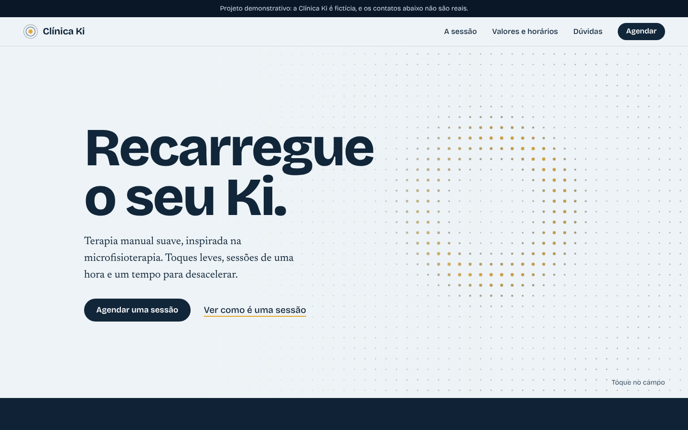
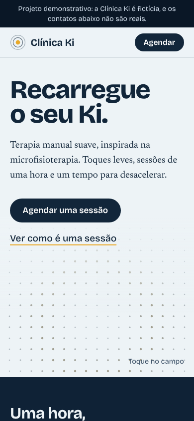
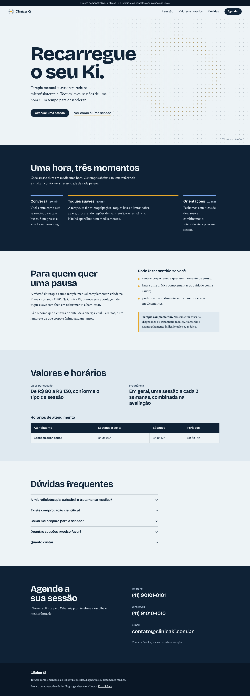

# Clínica Ki: landing page

Landing page de uma clínica **fictícia** de terapia manual suave, inspirada na microfisioterapia. Projeto de portfólio de front-end: HTML semântico, CSS responsivo e um pouco de JavaScript, sem frameworks e sem dependências.

**Site publicado:** https://eliassulzek.github.io/clinica-ki-landing-page/



## Visão geral

- **Objetivo:** apresentar a clínica, explicar como é uma sessão e levar a pessoa a agendar.
- **Ideia visual:** "micro" é o centro da técnica, então o herói é um campo de pontos finos que reage ao toque ou ao mouse com uma onda suave. O dourado só aparece onde a energia é tocada.
- **Conteúdo responsável:** o texto fala em relaxamento e bem-estar, deixa claro que a terapia é complementar e inclui uma pergunta sobre a base científica. Não há promessa de cura ou diagnóstico.
- **Aviso:** a clínica, os telefones e o e-mail são fictícios.

## Destaques técnicos

- Uma página só, com seções: herói, a sessão, para quem, valores e horários, dúvidas e contato
- HTML semântico, com `skip link`, landmarks, tabela com `caption` e `scope`, e `details/summary` nas dúvidas
- CSS com variáveis e *mobile-first*, sem rolagem horizontal da página a partir de 320 px
- Campo de pontos em `canvas`, com pausa fora da tela e com a aba oculta, e respeito a `prefers-reduced-motion`
- Contraste mínimo de 4,5:1 nos textos e foco de teclado visível
- Fontes hospedadas no repositório (sem requisições a terceiros)
- Imagens: nenhuma. A identidade usa SVG e CSS, sem arte protegida por direitos autorais

| Celular | Página completa |
| --- | --- |
|  |  |

## Estrutura

```
index.html
css/style.css
js/main.js
assets/fonts/       Bricolage Grotesque e Newsreader (licença OFL)
favicon.svg
prints/
```

## Como rodar

Abra `index.html` em um servidor estático (as fontes não carregam por `file://`):

```
python3 -m http.server 8000
```

Depois acesse `http://localhost:8000`.

## Como publicar no GitHub Pages

Em **Settings → Pages**, escolha **Deploy from a branch**, branch `main`, pasta `/ (root)`.

## Para usar como base de um site real

1. Troque os contatos fictícios na seção de contato.
2. Adicione um botão para o WhatsApp da clínica com o link `https://wa.me/<número>`.
3. Remova a faixa de projeto demonstrativo e ajuste o texto ao serviço real e às normas do conselho profissional da área.

## Créditos e licença

Desenvolvido por [Elias Sulzek](https://github.com/eliassulzek). Fontes: Bricolage Grotesque e Newsreader, ambas sob licença SIL Open Font License 1.1, distribuídas via Fontsource.

O código deste projeto está sob a licença MIT (veja o arquivo LICENSE). As fontes mantêm a licença original, SIL Open Font License 1.1.
